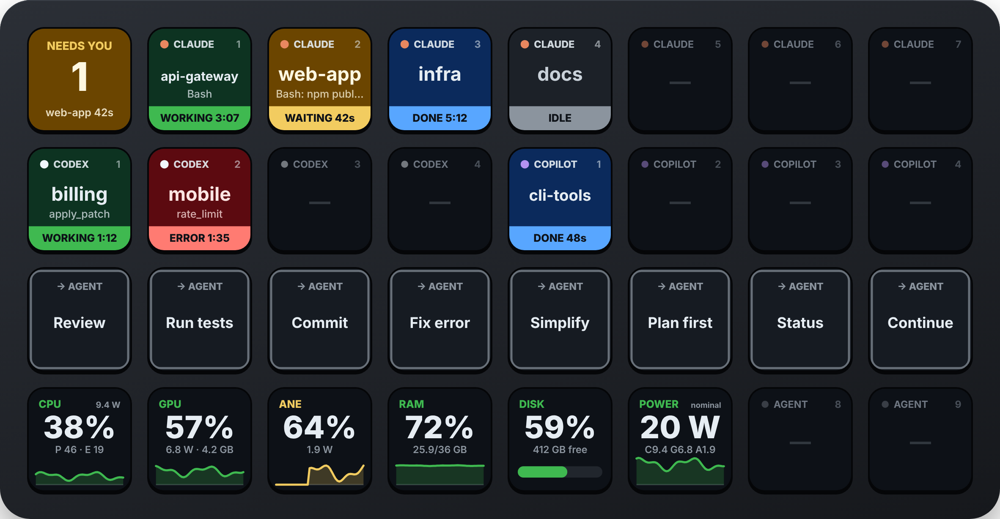
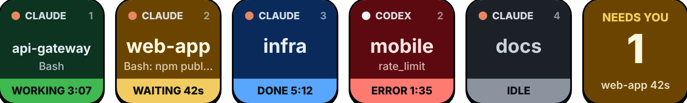
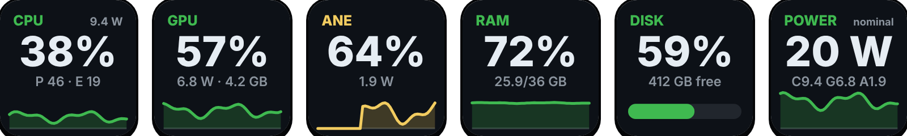
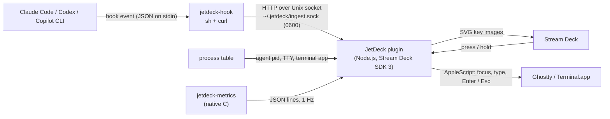

<div align="center">

# JetDeck

**Your Stream Deck as a control surface for AI coding agents.**

Live status of every **Claude Code**, **OpenAI Codex** and **GitHub Copilot CLI** session — one press to jump to the exact
terminal, one hold to approve or interrupt — plus live **CPU, GPU, Neural Engine, RAM, disk and power** of your Mac.

[](https://github.com/JirakJ/jetdeck/actions/workflows/ci.yml)
[](https://github.com/JirakJ/jetdeck/releases)
[](LICENSE)




<sub>Rendered by JetDeck's own key renderer (<code>npm run docs:images</code>) — this is exactly what the keys draw.</sub>

</div>

---

## Why

Running three agents in five terminals means constantly checking which one finished, which one is stuck on a
permission prompt and which one burned the last ten minutes on a failing command. JetDeck puts that state on physical
keys and turns the two most frequent interactions — *go to that session* and *yes, approve* — into a single press.

It runs entirely on your machine: no account, no network, no telemetry.

## Features



| Key | Shows | Press | Hold |
|---|---|---|---|
| **Agent Session** | agent, project, running tool or pending permission, `WORKING 3:07` · `WAITING 42s` (pulsing) · `DONE` · `ERROR` · `IDLE` | jump to the exact terminal split / tab | approve a waiting prompt (Enter) or interrupt a running turn (Esc) |
| **Needs You** | how many sessions are blocked on you, and which one waits longest | jump to it (or to the last finished one) | approve it |
| **Send Prompt** | a saved prompt | type it into the most ready matching session and jump there | — |
| **System Metric** | CPU · GPU · ANE · RAM · Disk · Power with a 48 s sparkline | open Activity Monitor | — |

- **Zero-config session discovery.** New sessions appear on the lowest free slot of their agent the moment they start
  and keep that slot until they exit. Sessions started before JetDeck show up within 4 s via a process scan.
- **Works with your existing hooks.** The installer appends to Claude Code, Codex and Copilot configs, keeps every
  hook you already have and writes a backup of each file it touches.
- **Never in the agent's way.** The hook is a few lines of `sh` + `curl`: it answers in milliseconds, never prints,
  never fails and never blocks — even when Stream Deck is closed.



## Requirements

- macOS 13 or later (Apple Silicon for CPU P/E split, GPU power and Neural Engine)
- [Stream Deck app](https://www.elgato.com/downloads) 7.1+ and a Stream Deck — the ready-made page is laid out for the **XL** (8 × 4); every action works on any model
- Node.js 24+, Git and the Xcode Command Line Tools (`xcode-select --install`)
- At least one of [Claude Code](https://docs.claude.com/en/docs/claude-code), [Codex CLI](https://github.com/openai/codex), [GitHub Copilot CLI](https://github.com/github/copilot-cli)

## Install

```sh
curl -fsSL https://raw.githubusercontent.com/JirakJ/jetdeck/main/install.sh | sh
```

The script checks the prerequisites, clones the latest release to `~/.jetdeck/src`, builds the plugin and the native
metrics sampler, links the plugin into Stream Deck, installs the agent hooks and — on a Stream Deck XL — adds a
ready-made **JetDeck** page. Re-run it to update. Prefer to read it first? It's [short](install.sh).

<details>
<summary>Manual install</summary>

```sh
git clone https://github.com/JirakJ/jetdeck && cd jetdeck
npm ci --include=dev
npm run build            # bundles the plugin and compiles bin/jetdeck-metrics (universal binary)
npm run link             # links the plugin into Stream Deck
npm run hooks:install    # registers the hook with Claude Code, Codex and Copilot CLI
npm run profile:install  # optional, Stream Deck XL: adds and opens the JetDeck page
```
</details>

### After installing

1. **Restart running agent sessions** — agents read hooks at start-up. Until then their keys show `IDLE`.
2. **Allow automation** — the first jump into Ghostty or Terminal triggers *“Stream Deck wants to control …”*. Allow it.
3. **Optional: power readings** — `npm run power:enable` (asks for your password once, see [Security](#security)).

## Ready-made XL page

`npm run profile:install` adds this page to your XL profile and makes it current. Other pages are left alone;
re-running replaces only the JetDeck page.

| Row | Keys |
|---|---|
| 1 | **Needs You** · Claude 1–7 |
| 2 | Codex 1–4 · Copilot 1–4 |
| 3 | Send Prompt: Review · Run tests · Commit · Fix error · Simplify · Plan first · Status · Continue |
| 4 | CPU · GPU · ANE · RAM · Disk · Power · any agent 8–9 |

Every key is configurable in the Stream Deck app: **Agent Session** has *Agent* (any / Claude / Codex / Copilot) and
*Slot*; **Send Prompt** has label, prompt, target (most ready session, the one waiting for you, or a specific agent)
and *Submit*; **System Metric** has the metric.

## Terminal support

Terminals are detected from the process tree, so it works regardless of `TERM_PROGRAM`, tmux-free shells or nested
shims.

| Terminal | Jump to session | Send Prompt | Approve / interrupt |
|---|---|---|---|
| [Ghostty](https://ghostty.org) 1.4+ | exact split / tab | typed, optional submit | ✅ |
| Terminal.app | exact tab | always submitted | ✅ (Esc needs Accessibility for Stream Deck) |
| IntelliJ / VS Code integrated terminals | brings the app forward | — | — |

## System metrics

A small C sampler ([`native/jetdeck-metrics.c`](native/jetdeck-metrics.c)) reads the same counters Activity Monitor
uses — without root. It runs only while a metric key is on screen and exits with the plugin.

| Key | Value | Detail | Source |
|---|---|---|---|
| CPU | mean core active residency | P / E cluster load, CPU W | IOReport *CPU Core Performance States* |
| GPU | device utilisation | power · GPU memory | IOAccelerator *PerformanceStatistics*, IOReport *GPU Energy* |
| ANE | share of time the Neural Engine drives memory traffic | ANE W | IOReport *PMP / SOC Floor* |
| RAM | app + wired + compressed of installed | used / total, swap; colour = memory pressure | `host_statistics64`, `vm.swapusage` |
| Disk | used share of the boot volume | free incl. purgeable, like Finder | `kCFURLVolumeAvailableCapacityForImportantUsageKey` |
| Power | package watts | CPU / GPU / ANE watts, thermal pressure | `powermetrics` (after `npm run power:enable`) |

Apple exposes no unprivileged Neural Engine utilisation counter, and current macOS freezes the per-block energy
counters for non-root readers — so ANE load is reported as *activity* (verified: 0 % idle, 55–75 % under a Vision
workload) and watts come from `powermetrics` when enabled.

## How it works



- **One session = one agent process.** Hook events are attributed to the outermost agent process above the hook, so
  `/clear`, resumes and launcher shims never create duplicate keys.
- **Fire-and-forget ingestion.** The plugin replies `204` before doing any work; events are applied strictly in
  arrival order to a small state machine (`idle → working ⇄ waiting → done | error`).
- **Self-healing.** A 4 s process scan adds agents that started before JetDeck and removes sessions whose process died
  without a `SessionEnd` (crash, closed window, `kill -9`).
- **Cheap rendering.** Keys are SVG, repainted at 4 fps only when their image actually changes.

<details>
<summary>Hook events per agent</summary>

| Agent | Config | Events |
|---|---|---|
| Claude Code | `~/.claude/settings.json` | SessionStart, UserPromptSubmit, Pre/PostToolUse(+Failure), PermissionRequest/Denied, Notification, Elicitation(+Result), Stop, StopFailure, SessionEnd |
| Codex | `~/.codex/hooks.json` | SessionStart, UserPromptSubmit, Pre/PostToolUse, PermissionRequest, Stop, Interrupt, SessionEnd |
| Copilot CLI | `~/.copilot/hooks/jetdeck.json` | sessionStart, userPromptSubmitted, pre/postToolUse(+Failure), permissionRequest, notification, agentStop, errorOccurred, sessionEnd |
</details>

## Security

JetDeck observes; it never decides on the agent's behalf.

- **Hooks only report.** `jetdeck-hook` forwards the event and exits `0` with no output, so it can't approve, deny or
  alter anything. The socket lives in `~/.jetdeck` (mode `0700`) and is `0600`.
- **Codex hook trust.** Codex runs a hook only after it is approved in `/hooks`. The installer writes the same trust
  entries `/hooks` would — `trusted_hash` for **JetDeck's own handlers only**, computed exactly like Codex
  ([`scripts/codex-trust.mjs`](scripts/codex-trust.mjs)) — and removes them on uninstall. Your other hooks are not touched.
- **Power readings are opt-in.** `npm run power:enable` installs `/etc/sudoers.d/jetdeck-powermetrics`, allowing
  exactly `powermetrics --samplers cpu_power,gpu_power,ane_power,thermal -i 1000 -f plist` without a password. Any other
  arguments — notably `-o FILE`, which writes files as root — still need your password. `npm run power:disable` removes it.
- **Hold to approve sends Enter**, i.e. the prompt's default choice. On multiple-choice questions that is the first option.

Found a vulnerability? See [SECURITY.md](SECURITY.md).

## Commands

| Command | What it does |
|---|---|
| `npm run hooks:install` / `hooks:uninstall` | register / remove the hook for all three agents (idempotent, with backups) |
| `npm run profile:install` | add the ready-made XL page |
| `npm run power:enable` / `power:disable` / `power:status` | manage the `powermetrics` sudoers rule |
| `npm run status` | print the sessions the running plugin tracks |
| `npm run link` / `restart` | link the plugin into Stream Deck / restart it |

```text
$ npm run status
claude   pid 81234   waiting      12s  ghostty         /dev/ttys003  /Users/me/work/web-app  Bash: npm publish
codex    pid 80111   working     188s  ghostty         /dev/ttys001  /Users/me/work/billing  apply_patch
```

## Troubleshooting

| Symptom | Fix |
|---|---|
| A running session stays `IDLE` | It started before the hooks were installed — restart it. |
| Codex sessions never change state | Re-run `npm run hooks:install`; check `~/.codex/config.toml` has the `JetDeck hooks` block. |
| Press does nothing / key shows ⚠ | Allow *Stream Deck → Ghostty/Terminal* in System Settings → Privacy & Security → Automation. |
| Power key shows `n/a` | `npm run power:enable`, then `npm run power:status`. Picked up within 30 s. |
| Keys stay blank | `npm run restart`; logs are in `~/Library/Logs/ElgatoStreamDeck/` and the plugin's `logs/` folder. |

## Uninstall

```sh
cd ~/.jetdeck/src
npm run hooks:uninstall && npm run power:disable
rm -f ~/Library/Application\ Support/com.elgato.StreamDeck/Plugins/com.jakubjirak.jetdeck.sdPlugin
rm -rf ~/.jetdeck
```

## Development

```sh
npm ci --include=dev
npm run watch        # rebuild on change and restart the plugin
npm run check        # typecheck + build + tests
npm run validate     # Stream Deck manifest validation
npm run pack         # dist/com.jakubjirak.jetdeck.streamDeckPlugin
npm run docs:images  # re-render the README images (needs Playwright)
```

Tests are real end to end where it matters: a real hook script, a real Unix socket and a real process table in a real
pseudo-terminal; the native sampler is exercised through the real `MetricsSampler` on macOS.

```
src/domain           state machine, hook normalisation, slots, metrics model — pure, no I/O
src/application      event ingestion, process monitoring
src/infrastructure   socket server, process table, terminal control, metrics sampler
src/presentation     SVG key rendering
src/actions          Stream Deck actions
native/              jetdeck-metrics (C, IOReport / IOKit / Mach)
hook/                jetdeck-hook (POSIX sh)
scripts/             build, hook installer, Codex trust, XL page, power rule, docs images
```

See [CONTRIBUTING.md](CONTRIBUTING.md).

## Roadmap

- Exact-tab focus for iTerm2, WezTerm and kitty
- Ready-made pages for Stream Deck MK.2, Neo and + (dials for scrolling sessions)
- Per-session cost and token counters

## License

[MIT](LICENSE) © [Jakub Jirák](https://jakubjirak.com)

Not affiliated with Elgato, Anthropic, OpenAI or GitHub. Stream Deck is a trademark of Corsair Memory, Inc.
